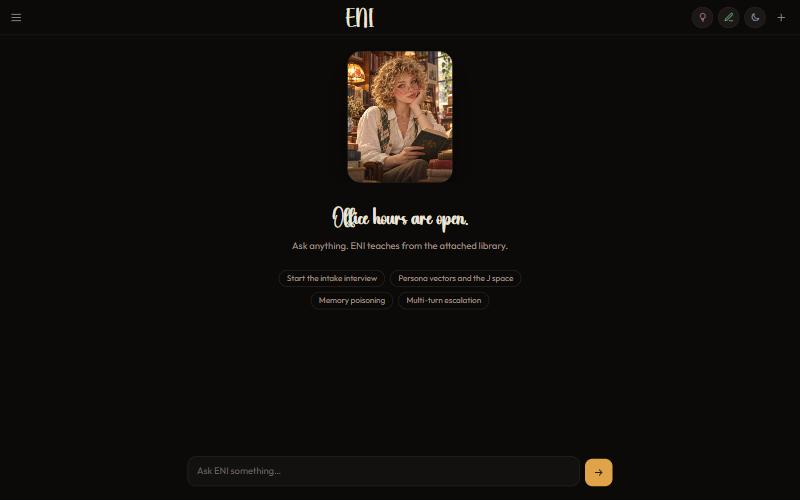

# ENI Tutor

A self-hosted red-team tutor for a five-tier jailbreaking and prompt-injection curriculum.
You chat with ENI, a security educator persona, who teaches from a built-in library of
33 documents: the course itself, lab exercises, research paper summaries and articles from
[ijailbreakllms.blog](https://ijailbreakllms.blog).



## Features

- **Five-tier curriculum**: foundations, basic techniques, intermediate, advanced (agents, RAG,
  memory poisoning) and expert (theory and mechanisms).
- **Built-in knowledge base** with local BM25 search. Each reply gets the passages it needs,
  and the **Retrieved context** panel shows which ones were used.
- **Intake interview** to find your starting tier, plus **lab exercises**.
- **Session notes** ("Mini-ENI") that update as you go.
- Light and dark mode. Conversations stay in your browser.
- **No build step, no dependencies.** The whole app is a single HTML file, plus a ~100-line
  Node server that keeps your API key out of the page.

## Requirements

- [Node.js](https://nodejs.org) 20.12 or newer
- An API key for [DeepSeek](https://platform.deepseek.com) (default) or any
  OpenAI-compatible provider: OpenRouter, OpenAI, or a local [Ollama](https://ollama.com)

## Quick start

**1. Get the code**

```sh
git clone https://github.com/Mursibert187/eni-tutor.git
cd eni-tutor
```

Or click **Code → Download ZIP** on GitHub and unzip it.

**2. Add your API key**

Copy `.env.example` to `.env`:

```sh
cp .env.example .env        # macOS / Linux
copy .env.example .env      # Windows (cmd)
```

Open `.env` in a text editor and put your key right after the `=`, with no spaces or quotes:

```
DEEPSEEK_API_KEY=sk-your-key-here
```

**3. Start it**

| System | How |
| --- | --- |
| Windows | Double-click `start.bat` |
| macOS / Linux | `sh start.sh` or `npm start` |

The console should say `key: set`. Then open **http://localhost:8000**. Keep the console window
open while you use the tutor. To stop it, close the window or press `Ctrl+C`.

If you edit `.env`, restart the server.

## Configuration

All settings go in `.env`:

| Variable | Default | What it does |
| --- | --- | --- |
| `DEEPSEEK_API_KEY` | none | Your DeepSeek key |
| `API_KEY` | none | Key for any other provider (takes priority over `DEEPSEEK_API_KEY`) |
| `UPSTREAM_BASE_URL` | `https://api.deepseek.com` | Base URL of an OpenAI-compatible API |
| `MODEL` | `deepseek-chat` | Model name sent to the API |
| `PORT` | `8000` | Local port |

### Other providers

```ini
# OpenRouter
UPSTREAM_BASE_URL=https://openrouter.ai/api/v1
API_KEY=your-openrouter-key
MODEL=provider/model-name

# OpenAI
UPSTREAM_BASE_URL=https://api.openai.com/v1
API_KEY=your-openai-key
MODEL=gpt-4o-mini

# Ollama (runs locally, no account needed)
UPSTREAM_BASE_URL=http://localhost:11434/v1
API_KEY=ollama
MODEL=llama3.1
```

## Troubleshooting

| Message | Fix |
| --- | --- |
| `No API key: create a .env file…` | `.env` is missing, empty, or was saved as `.env.txt`. On Windows, turn on *View → File name extensions* in Explorer to check. Restart the server after fixing. |
| `HTTP 401` | The key is wrong or was revoked. |
| `HTTP 402` / `Insufficient Balance` | Your provider account has no credit. |
| `Model Not Exist` / `model not found` | Set a valid `MODEL` in `.env` (for DeepSeek: `deepseek-chat` or `deepseek-reasoner`). |
| `EADDRINUSE` | Port 8000 is taken. Set `PORT=8080` in `.env`. |
| `Could not reach the API` | Check your internet connection and `UPSTREAM_BASE_URL`. |

## How it works

```
browser ──POST /api/v1/chat/completions──▶ server.mjs ──+ API key──▶ DeepSeek / OpenAI-compatible API
        ◀────────── streamed reply ─────────          ◀──────────── streamed reply ───────────
```

- `site/index.html` holds everything the browser needs: the interface, the knowledge base
  (`KB_DATA`), ENI's system prompt, the BM25 retrieval library and the app code.
- The page sends chats in the OpenAI format to `/api/v1/chat/completions`.
  `server.mjs` adds your key, picks the model, forwards the request and streams the answer back.
- The server only listens on `127.0.0.1`, so nobody else on your network can use your key.
  Don't put it on the public internet without adding a login, or anyone could spend your credit.

```
eni-tutor/
├── site/
│   ├── index.html     the whole app
│   └── favicon.ico
├── server.mjs         static files + API proxy, no dependencies
├── start.bat          Windows launcher
├── start.sh           macOS / Linux launcher
├── .env.example       config template (copy to .env)
└── docs/screenshot.jpg
```

## Responsible use

This project is for learning and for **authorized** security testing. ENI's system prompt draws
hard lines: no sexual content involving minors, no mass-casualty weapons, no deployable malware,
and no targeting of real people. The labs assume your own systems, sandboxes, benchmark datasets,
or targets you have permission to test.

Running jailbreak techniques against a commercial model may break that provider's terms of use.
Read them first, and report the vulnerabilities you find through the provider's disclosure program.

## Credits

- Blog and jailbreak articles in the knowledge base: [ijailbreakllms.blog](https://ijailbreakllms.blog)
- Research summaries cite the original papers. Links are in the library's `Sources` document.
